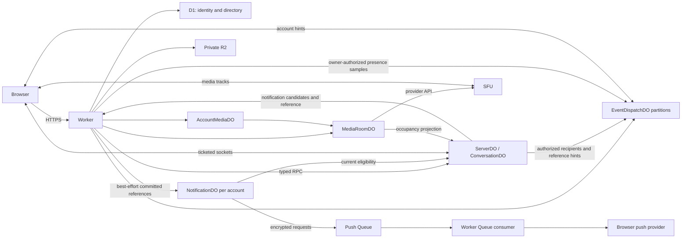

# Architecture

vaskel. is one independently operated Cloudflare application: shared accounts and
DMs, several circles with their own rooms and permissions, and private
attachments. The interface calls servers **circles** and channels **rooms**;
code retains `server` and `channel`. Instances do not federate.
[Product policies](product-review.md) define the intended behavior.

## State ownership

| Owner             | Authority                                                                        | Identity                        |
| ----------------- | -------------------------------------------------------------------------------- | ------------------------------- |
| D1                | Accounts, sessions, instance policy, directory and creation receipts             | Installation                    |
| `ServerDO`        | Membership, roles, channels, messages, FTS, read positions and command receipts  | Server UUID                     |
| `ConversationDO`  | Participants, direct-message blocking, messages, FTS, reads and receipts         | Conversation UUID               |
| `EventDispatchDO` | Account notification sockets, revocation fences and sampled connectivity         | Fixed account-ID partition      |
| `NotificationDO`  | Browser subscriptions, VAPID keys, attention preferences and waiting push groups | User UUID                       |
| Queue             | Prepared encrypted push requests awaiting transport                              | Installation                    |
| `AccountMediaDO`  | One account's media intent, endpoint capability and transfer generation          | User UUID                       |
| `MediaRoomDO`     | Participants, SFU sessions, publications, negotiation and forwarding cleanup     | Server/channel or DM-call scope |
| R2                | Private file bytes; their message owner authorizes their lifecycle               | Opaque owner-scoped key         |
| Worker            | Authentication, external validation, HTTP mapping and bounded orchestration      | Stateless                       |
| Realtime SFU      | Audio/video transport under the operator's SFU application                       | Provider session                |

D1 contains no canonical messages or global message-search mirror. Directory and
membership references nominate owners; they never grant access. One ServerDO
keeps authorization, message mutation and FTS in one transaction. Its channels
consequently share storage and execution capacity. DMs belong to instance
accounts and survive departure from an unrelated circle.

Notification hubs derive connectivity from eligible hibernating sockets and
persist admission/session fences and the last observed online bit for transition
detection. Message owners authorize event recipients and presence candidates;
hubs hold no membership graph. Presence reads compose bounded owner authorization and hub samples.
Notification or presence failure cannot change a committed command, block a
room stream or end a call.

[NotificationDO](notifications.md) owns browser push independently of
EventDispatchDO's account-event sockets. Message owners retain eligibility;
the application Worker's Queue consumer owns provider transport.

## Decisions that must stay local

The Worker supplies a verified principal and typed command. The owner checks
current permission, version, generation and retry identity in the same native
transaction as the mutation. A Worker read followed by an unconditional actor
write cannot preserve that boundary. Native D1 batches cover known identity
statements; cross-actor RPC, R2 and SFU work remain outside local SQL
transactions. [Engineering](engineering.md#native-transactions) explains the
adapter constraints.

An accepted command means durable owner state. Its stable receipt survives an
interrupted response; acknowledgement does not promise recipient delivery.
Preserve its original ID, issue time and payload on retry. A matching receipt is
resolved before policies for a new allocation. Expired retry identity must not
become a fresh operation after receipt compaction.

Durable work records its obligation and wakeup before external I/O. Completion
rechecks the exact claim and current state. A timeout ends the caller's wait,
without proving that an RPC or writer stopped. Bounded work keeps the operation's
concurrency slot until it settles. Notification offers run in the calling
Worker's request, outside actor pools. Actor hints and maintenance use separate
pools, so stalled hints cannot exhaust cleanup slots. The
[bounded-work implementation](../apps/server/src/actors/shared/bounded-work.ts) and
[shared scheduler](../apps/server/src/actors/shared/maintenance.ts) own numeric
limits and earliest-deadline calculation.

Push deliberately consumes waiting groups before external preparation; a crash
can lose an alert. Its [dispatch contract](notifications.md#waiting-dispatch-and-transport)
does not extend accepted-command recovery into a durable delivery guarantee.

The highest assigned owner sequence (event high-water) survives replay pruning;
account/media generations survive disposal of old details. These authority
records must not be inferred
from whichever event, session or payload rows remain. Cancellation, permission
loss and delayed responses must not resurrect private cache contents or ended
media intent.

## Read the contract for the change

Use the [topic index](README.md#topics) for access, messages,
synchronization, files, client state and media.

Public shapes live in [executable contracts](../packages/contracts/src), bindings in
[Wrangler configuration](../apps/server/wrangler.jsonc), and storage layout beside each
owner.
