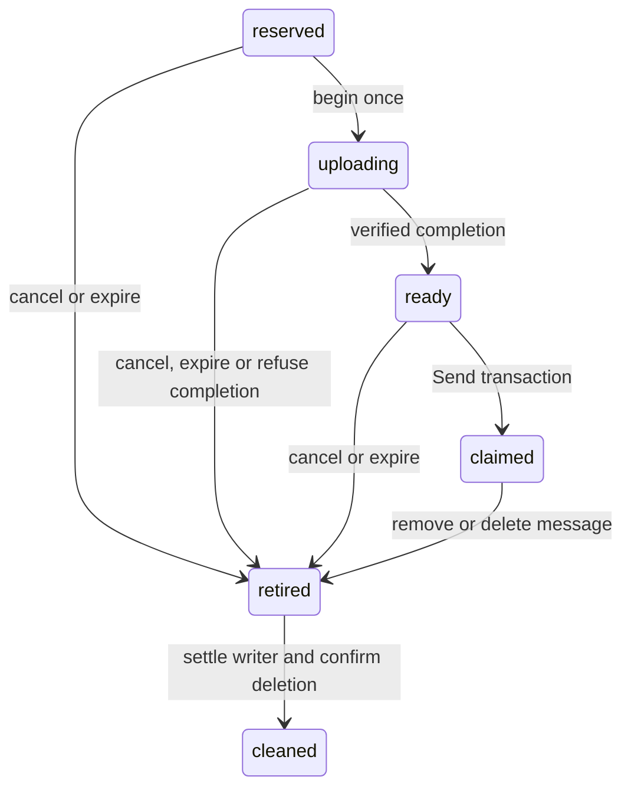

# Private attachments

A file has one immutable key, one admitted writer and at most one message claim.
ServerDO/ConversationDO owns metadata, authorization and accounting; R2 holds
private bytes. [Executable contracts](../packages/contracts/src/attachments.ts) own
fields and numeric quotas. There is no reusable blob service, public bucket or
browser completion ticket.

## Reserve, write and claim

1. **Reserve:** current send permission, command identity and quotas are checked
   in the owner transaction. Persist a random file ID/private key before any R2
   write. Charge declared bytes and arm expiry. Keys contain no filename or
   credential.
2. **Begin once:** recheck uploader, permission, deadline and reserved state
   atomically. Only the winner receives a trusted writer descriptor. A duplicate
   begin returns state, never another write grant; losing the response may waste
   an attempt.
3. **Stream once:** the Worker writes outside SQL with backpressure,
   observed-byte counting, an exact-length stream and deadline. Check both short
   and long bodies without buffering the entire file or requiring browser
   `Content-Length`. Conditional create guards overwrite; an ambiguous PUT is
   never blindly repeated against the key.
4. **Complete:** refresh the same real D1 session after I/O, then recheck
   current permission, owner generation, deadline, cancellation, quarantine and
   observed size/object identity in the owner transaction. Exact completion is
   idempotent. Refused or stale completion must still account for the writer
   through trusted cleanup, without making a retired file ready.
5. **Claim:** Send recovers its accepted receipt first. For a fresh command,
   validate every ordered unique file before mutation, then claim them with
   message, FTS, event, high-water and receipt in one native transaction. A
   failed invariant/write rolls back everything; broadcast follows commit.

The state cannot move back from retirement. A crash after PUT but before
completion can require a fresh reservation and explicit upload retry; no second
recovery-to-ready workflow is promised. Uploader status resolves an ambiguous
reservation/PUT without admitting another writer. Claimed status is a
reconciliation signal, not permission to delete bytes.

Charge reservations, live files, deletion grace, holds and unresolved retired
writers against owner storage. Claiming releases outstanding-upload counts/bytes
while retaining storage liability. Uncertain writers retain both. Release each
charge exactly once after cleanup or expiry of a known never-started
reservation. Expiry alone cannot release an uncertain writer's charge.
[State transitions](../apps/server/src/actors/shared/attachments/state.ts),
[commands](../apps/server/src/actors/shared/attachments/commands.ts) and
[upload transport](../apps/server/src/files/upload.ts) own these decisions.

## Grants, downloads and cancellation

Public descriptors contain filename/length and file identity, never a key,
secret or object version. Status is uploader-only with current channel read
access and never exposes deleted/quarantined material. Unclaimed ready files
provide status, not a grant; the uploader already holds their local bytes.

An authenticated request asks the message owner to check current channel access
and authorize a download grant for one immutable, claimed, live file that is not
quarantined. The byte route then verifies that grant without repeating account
or owner reads. This lets previews, downloads and playback ranges share one
authorization decision.

An issued URL is bearer access for a fixed hour, including after logout,
permission removal, deletion or quarantine. Issued grants are not tracked or
revoked; a replacement requires fresh authorization. The grant contains signed,
non-secret file metadata, never R2 credentials. Object identity checks prevent
a replaced or deleted object from serving under an old grant. Minting counts
against the per-user budget; serving does not.

Leading bytes decide which files may render inline; filenames and upload MIME
cannot grant that authority. Responses sanitize filenames and forbid MIME
sniffing. Other types remain downloads. Byte ranges support video seeking, and
private browser caching revalidates the grant. A browser may
reuse a decoded image without another request. Sign-out requests best-effort
cache clearing, but cannot guarantee downloaded bytes disappear with the session.
[Grants](../apps/server/src/files/grant.ts),
[byte serving](../apps/server/src/files/download.ts) and
[owner admission](../apps/server/src/actors/shared/attachments/download.ts)
define the token, transport and admission details.

Cancel and Send serialize in the same owner. Cancel first prevents claim; Send
first returns `attachment_claimed` to cancellation and requires ordinary message
removal/deletion. The authenticated uploader may perform contentless discard
after channel-access loss. An aborted browser request, expired lease or timeout
does not replace this server decision. Author-only claimed-file removal is a
versioned [message operation](messaging.md#captured-quotes).

The client reserves/uploads selected files and freezes their ordered IDs with
the Send command. Reconcile an ambiguous Send receipt before discarding
potentially claimed files. Navigation, account retirement and delayed responses
retain the original draft/account lifetime. Abort requests and revoke URLs on
teardown; owner deadlines cover lost teardown requests.
[Draft persistence](client-storage.md#authored-drafts) retains bytes and exact
attempts without creating an offline send queue.

## Retirement and late writes

Deletion hides message/file material immediately and schedules ordinary claimed
bytes for seven-day payload GC. Unpublished canceled/expired files may clean
sooner. Before external deletion, the owner transaction rechecks live
references, current state and preservation holds and claims the exact key
irreversibly. A hold committed before that claim wins; a later hold cannot
promise recovery. Quarantine and deletion refuse new grants at once, without
asserting a scan verdict or deletion; URLs issued earlier serve until they
expire or the object is deleted. Restricted incident handling grants no general
DM/deleted-body browser.

**An absent object or successful DELETE does not prove an unresolved PUT will
never arrive.** Record writer settlement from a trusted completion, exact
matching object observation or trusted proof PUT was never invoked. Abort,
timeout and absent HEAD cannot establish it. Persist settlement before deleting
an observed object; mismatched identity is a cleanup failure, not a new object
to adopt.

An unresolved retired write retains its key, charge and recurring probe even
after an earlier DELETE. Late matching objects are deleted under the retirement
fence. Final cleanup requires successful deletion _after_ recorded settlement;
an earlier deletion cannot satisfy that ordering. Late callbacks cannot revive
the file, clear a newer cleanup claim or change another key. An absent uncertain
writer retains its small obligation and allocation charge; outstanding limits
apply backpressure. Every possible key was recorded before PUT and is never
reused, so no bucket-wide attachment inventory is required.

Each bounded cleanup pass persists a lease/recovery wakeup before awaiting R2
and conditionally acknowledges the same claim. One earliest-deadline scheduler
covers file expiry/cleanup, payload GC, sockets and media invalidation. A slow
R2 call or failure in one drain must leave other deadlines armed. Bound external
waits as well as selected rows, retaining unsettled work slots and durable
continuation. Source:
[cleanup](../apps/server/src/actors/shared/attachments/cleanup.ts),
[shared maintenance](../apps/server/src/actors/shared/maintenance.ts).

## Inline previews and the media viewer

Local previews admit raster images from their leading bytes, never filenames
or declared MIME. The [preview resource](../apps/client/src/features/files/preview-resource.ts)
owns its object URL, rejects superseded loads and releases it on replacement,
failure or unmount. Signature admission proves neither decoding nor safety;
failure preserves the plain file row.

An account keeps one in-memory grant per sent file, shared by previews, the
viewer and downloads; it is never persisted. Previews load only online. Download and
Try again can refresh an expired grant; an open viewer keeps its URL without
background renewal. Grant or decoding failures stay local to the file, with
explicit retry. Failed download refresh leaves already shown media in place.

Video thumbnails use the first verified keyframe, which can be black or
unrepresentative. They inherit the original file's grant and source checks.
Successful thumbnails and explicit unsupported-format results can be cached
privately for a short period capped by grant expiry; transient failures are
not cached. Generated PNGs are returned directly rather than stored as another
attachment, keeping accounting and deletion with the original file.

[Bounded extraction](../apps/server/src/files/thumbnail.ts) supports 8-bit 4:2:0
SDR H.264, HEVC, VP8 and VP9 in MP4/QuickTime or WebM. Unsupported or damaged
input or an extraction limit can leave the tile without an image. Thumbnail
failure does not prevent trying to play or download the original.

The [viewer](../apps/client/src/features/files/media-lightbox.tsx) outlives its
virtualized opener row and closes on dismissal or account teardown. A room
access change does not hide already open media. Browser autoplay refusal leaves
native playback controls available. Encoded-byte limits do not bound decoded
media memory. The [grant owner](../apps/client/src/features/files/use-attachment-grant.ts)
and [raster admission](../apps/client/src/features/files/raster-image.ts) retain
the client boundaries.

## Verification

Local actor, transport and browser tests do not establish deployed private-file
delivery or decoding and memory behavior across supported devices. Safari/iOS
playback and H.264 availability remain unverified locally; these retain
[separate acceptance](readiness.md#evidence-limits).
